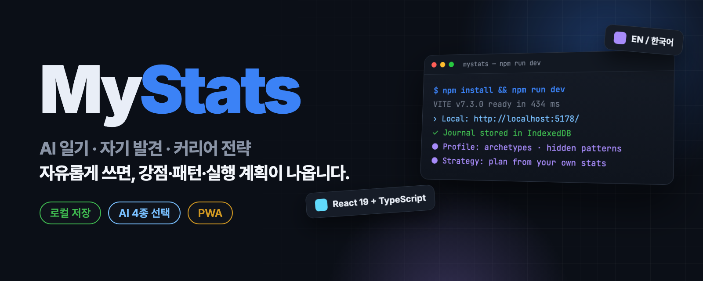
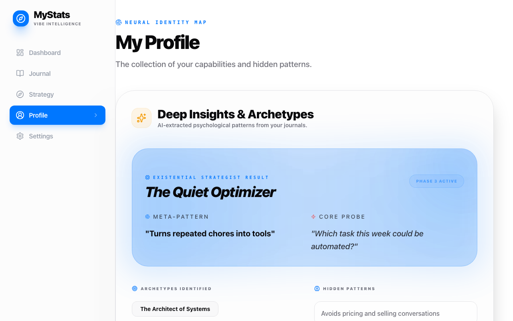
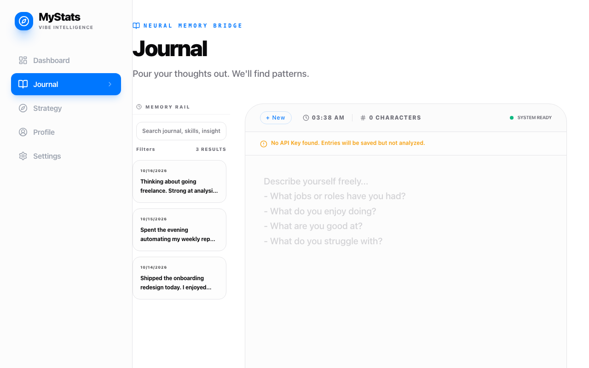
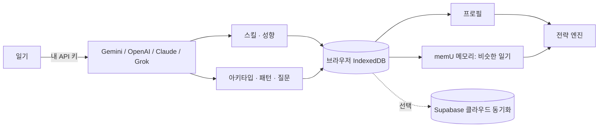

<p align="center">
  
</p>

<p align="center">
  <a href="README.md"><b>English</b></a> · <b>한국어</b>
</p>

<h2 align="center">오늘 있었던 일을 쓰세요.<br>MyStats가 강점·패턴·실행 계획으로 정리해 줍니다.</h2>

<p align="center">
  브라우저에서 돌아가는 로컬 우선 AI 일기 · 커리어 전략 앱입니다.<br>
  Gemini, OpenAI, Claude, Grok 중 내 API 키를 넣어 쓰고, 기록은 내 기기에 남습니다.
</p>

<p align="center">
  <a href="https://mystats-eta.vercel.app"></a>
  <a href="LICENSE"></a>
  <a href="https://github.com/kks0488/mystats/actions/workflows/ci.yml"></a>
  <a href="https://github.com/kks0488/mystats/releases"></a>
  
  
  <a href="https://github.com/kks0488/mystats/stargazers"></a>
</p>

<table>
<tr>
<td width="50%" valign="top">

### 행간까지 읽는 일기
형식 없이 쓰면 됩니다. 일기마다 하드·소프트 스킬, 성향, 아키타입, 스스로에게 던져야 할 질문을 뽑아냅니다.

</td>
<td width="50%" valign="top">

### 저절로 쌓이는 프로필
스킬·아키타입·숨은 패턴이 일기를 쓸수록 쌓입니다. 버튼 하나로 전체 일기를 다시 분석해 프로필을 새로 만듭니다.

</td>
</tr>
<tr>
<td width="50%" valign="top">

### 내 데이터로 짜는 전략
고민을 적으면 내 강점을 활용하고 사각지대를 짚어 주는 계획이 나옵니다. 전략 보관함에서 저장·검색·수정할 수 있습니다.

</td>
<td width="50%" valign="top">

### 기본은 비공개
데이터는 브라우저(IndexedDB)에 저장되고 필수 서버가 없습니다. Supabase 클라우드 동기화는 선택이며 로그인했을 때만 동작합니다.

</td>
</tr>
</table>

## 바로 써 보기

라이브 앱: **[mystats-eta.vercel.app](https://mystats-eta.vercel.app)**

1. **Settings → API Key**: 제공사를 고르고 키를 붙여 넣습니다([Gemini](https://aistudio.google.com/app/apikey)는 무료 등급이 있습니다).
2. **Journal**: 일·성과·실패·막힌 점 등 무엇이든 씁니다. `Ctrl/Cmd + Enter`로 저장합니다.
3. **Profile**과 **Strategy**: 내 패턴을 읽고, 계획을 요청합니다.

앱처럼 설치(PWA)도 됩니다. iOS는 *공유 → 홈 화면에 추가*, Android·Chrome은 *앱 설치*를 누릅니다.

## 내 PC에서 실행

```bash
git clone https://github.com/kks0488/mystats.git
cd mystats
npm install
npm run dev        # http://localhost:5178
```

Node.js 20 이상이 필요합니다. 시작할 때 `.env`는 없어도 됩니다. 클라우드 동기화·memU 서버·Sentry 설정은 [`.env.example`](.env.example)을 보세요.

## 화면

<p align="center">
  
</p>
<p align="center">
  
</p>
<p align="center"><sub>예시 일기를 넣어 로컬에서 실행한 화면입니다(실제 사용자 데이터 아님).</sub></p>

## 동작 방식



요청은 브라우저에서 내가 고른 AI 제공사로 바로 갑니다. 내장 memU 레이어가 관련된 과거 일기를 로컬에서 찾아 전략의 맥락으로 붙입니다.

## 자주 묻는 질문

**데이터는 어디에 저장되나요?**
브라우저의 IndexedDB(안 되면 localStorage)에 저장됩니다. Settings에서 언제든 JSON으로 백업할 수 있습니다. 클라우드 동기화에 로그인하지 않으면 아무것도 올라가지 않습니다.

**AI 비용을 내야 하나요?**
내 키를 씁니다. Gemini는 무료 등급이 있고, 다른 제공사는 해당 회사가 직접 청구합니다.

**한국어로 쓸 수 있나요?**
네. 상단에서 영어와 한국어를 바꿀 수 있습니다.

## 로드맵

계획 단계이며 아직 만들지 않았습니다(프로젝트 계획 문서 기준):

- **타임라인 / 변화 추적**: 프로필이 시간에 따라 어떻게 바뀌는지, 월간 변화 요약
- **그림자 프로필**: 6개 삶의 영역을 레이더로 보여 주고 거의 쓰지 않는 영역을 짚어 줌
- **클라우드 동기화**: 재시도와 더 명확한 동기화 상태 표시(현재 베타)

<details>
<summary><b>기술 상세</b></summary>

### 기능 상세

- **Journal**: 일기마다 스킬(하드·소프트), 성향, 아키타입, 핵심 질문 추출. Journal Explorer 검색·필터(기간, 기록 종류, 인사이트 유무, 스킬 분류). 임시 저장 자동 보관·복원. `Ctrl/Cmd + Enter` 저장.
- **Profile**: 아키타입, 숨은 행동 패턴, 핵심 질문, 스킬·관심사 개요. *Rebuild AI Profile*로 전체 일기 재분석.
- **Strategy**: 나만의 강점 분석, 사고 모델(제1원리, 80/20, 역발상), 구체적 실행 계획, 사각지대 경고, 전략 보관함(저장·검색·불러오기·수정·복사·삭제), 스킬·아키타입·일기를 직접 골라 맥락으로 넣는 Context Builder.
- **memU 메모리 레이어**: *Embedded* 모드(기본)는 브라우저 안에서 일기를 메모리로 사용(`retrieve` 유사 기록 top-K, `check-similar` 중복 감지). *Server (API)* 모드는 로컬 memU REST 서버(`MEMU_API_URL`, 기본 `http://localhost:8100`)를 쓰고 Strategy에 `project-registry` 메모리를 포함할 수 있습니다.
- **클라우드 동기화(베타, 선택)**: Supabase Auth + Postgres. Google OAuth, GitHub OAuth(선택), 이메일·비밀번호 로그인. Supabase에서 리디렉트 URL을 허용해야 합니다 — [`docs/CLOUD_SYNC.md`](docs/CLOUD_SYNC.md) 참고. OAuth 리디렉트 후 URL에서 토큰을 지웁니다.
- **Chrome 실행기**: `chrome://extensions` → 개발자 모드 → 압축해제된 확장 프로그램 로드에서 [`chrome-extension/`](chrome-extension/)을 선택하면 툴바에서 PWA를 열 수 있습니다.

### 기술 스택

| 분류 | 기술 |
| --- | --- |
| 프레임워크 | React 19 + Vite 7 |
| 언어 | TypeScript 5.9 (strict) |
| 스타일 | Tailwind CSS 3 + shadcn/ui, Framer Motion |
| AI | Gemini / OpenAI / Claude / Grok (내 키 사용) |
| 로컬 데이터 | IndexedDB (`idb`) + localStorage 대체 저장 |
| 클라우드 동기화 | Supabase (선택) |
| 검증 | Zod 4 |
| 라우팅 | React Router 7 |
| 오류 추적 | Sentry (선택, 지연 로딩) |
| PWA | vite-plugin-pwa (Workbox) |
| 테스트 | Vitest + Testing Library, Playwright (E2E) |
| CI/CD | GitHub Actions (CI, CodeQL, 비밀값 검사) → Vercel |

### 스크립트

| 명령 | 하는 일 |
| --- | --- |
| `npm run dev` | 개발 서버 시작(포트 `5178`, 또는 `PORT` / `VITE_PORT`) |
| `npm run build` | 타입 검사 후 `dist/`로 빌드 |
| `npm run preview` | 빌드 결과 미리보기 |
| `npm run lint` | ESLint |
| `npm test` | Vitest 단위 테스트 |
| `npm run test:e2e` | Playwright E2E 테스트(먼저 `npm run test:e2e:install`) |

### 프로젝트 구조

```
mystats/
├── src/
│   ├── bootstrap/appInit.ts   # Sentry, DB 마이그레이션, OAuth, 클라우드 동기화
│   ├── components/            # 레이아웃, shadcn/ui, ErrorBoundary, PWA 안내
│   ├── db/                    # IndexedDB 스키마·마이그레이션 + localStorage 대체 저장
│   ├── hooks/                 # useLanguage, useDbRecovery
│   ├── lib/                   # ai-provider, memu(+worker), cloudSync, backup, journalExplorer, translations…
│   └── pages/                 # Home, Journal, Profile, Strategy, Settings(+ 설정 카드)
├── e2e/                       # Playwright 테스트
├── chrome-extension/          # 툴바 실행기
├── supabase/                  # SQL 마이그레이션
├── docs/                      # 클라우드 동기화·마이그레이션·배포 메모
└── public/                    # PWA manifest, 아이콘
```

### 개인정보

- 일기·스킬·인사이트는 기본적으로 브라우저에 저장됩니다.
- API 키는 브라우저에 보관되며 내가 고른 제공사로만 전송됩니다.
- memU Embedded 모드는 로컬에서 동작하고, Server 모드에서는 내 memU 서비스로 일기가 전송됩니다.
- 클라우드 동기화는 로그인하고 켰을 때만 동작합니다.
- 언제든 JSON으로 내보낼 수 있습니다.

변경 기록: [`CHANGELOG.md`](CHANGELOG.md) · 보안: [`SECURITY.md`](SECURITY.md) · 기여: [`CONTRIBUTING.md`](CONTRIBUTING.md)

</details>

## 라이선스

[MIT](LICENSE) © Kyoungsoo Kim
