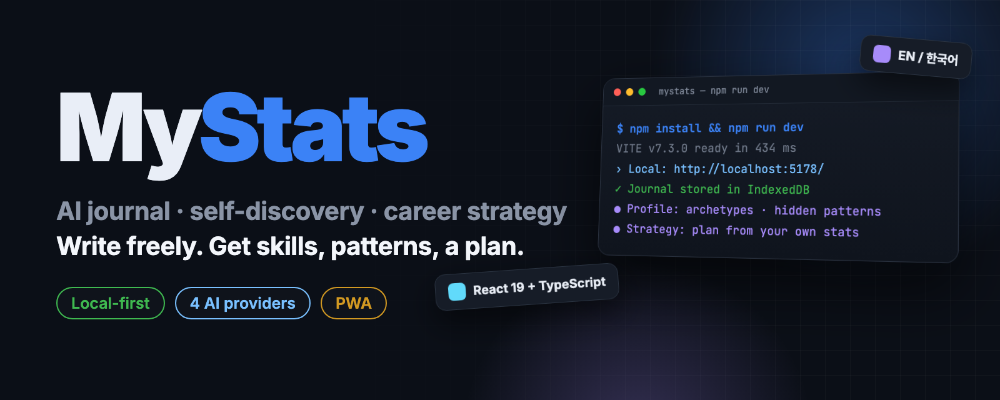
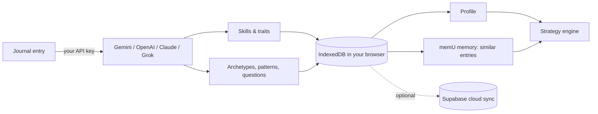

<p align="center">
  
</p>

<p align="center">
  <b>English</b> · <a href="README.ko.md"><b>한국어</b></a>
</p>

<h2 align="center">Write about your day.<br>MyStats turns it into your skills, patterns and a plan.</h2>

<p align="center">
  A local-first AI journal and career strategy app that runs in your browser.<br>
  Bring your own key for Gemini, OpenAI, Claude or Grok. Your entries stay on your device.
</p>

<p align="center">
  <a href="https://mystats-eta.vercel.app"></a>
  <a href="LICENSE"></a>
  <a href="https://github.com/kks0488/mystats/actions/workflows/ci.yml"></a>
  <a href="https://github.com/kks0488/mystats/releases"></a>
  
  
  <a href="https://github.com/kks0488/mystats/stargazers"></a>
</p>

<table>
<tr>
<td width="50%" valign="top">

### Journal that reads between the lines
Write freely. Each entry is analyzed for hard and soft skills, traits, archetypes and the questions you should be asking yourself.

</td>
<td width="50%" valign="top">

### A profile that builds itself
Skills, archetypes and hidden patterns add up across entries. One click rebuilds the whole profile from every journal entry.

</td>
</tr>
<tr>
<td width="50%" valign="top">

### Strategy from your own stats
Describe a problem and get a plan that uses your strengths and warns about blind spots. Save, search and edit plans in the Strategy Vault.

</td>
<td width="50%" valign="top">

### Private by default
Data lives in your browser (IndexedDB). There is no required backend. Cloud sync through Supabase is optional and only runs when you sign in.

</td>
</tr>
</table>

## Try it

Open the live app: **[mystats-eta.vercel.app](https://mystats-eta.vercel.app)**

1. **Settings → API Key**: pick a provider and paste your key ([Gemini](https://aistudio.google.com/app/apikey) has a free tier).
2. **Journal**: write anything — work, wins, failures, what you are stuck on. `Ctrl/Cmd + Enter` saves.
3. **Profile** and **Strategy**: read your patterns, then ask for a plan.

It also installs as an app (PWA): on iOS use *Share → Add to Home Screen*, on Android/Chrome use *Install app*.

## Run it locally

```bash
git clone https://github.com/kks0488/mystats.git
cd mystats
npm install
npm run dev        # http://localhost:5178
```

Requires Node.js 20 or later. No `.env` is needed to start; see [`.env.example`](.env.example) for the optional cloud sync, memU server and Sentry settings.

## Screenshots

<p align="center">
  
</p>
<p align="center">
  
</p>
<p align="center"><sub>Captured from a local run with sample entries (no real user data).</sub></p>

## How it works



Requests go straight from your browser to the AI provider you chose. The built-in memU layer finds related past entries locally and adds them as context for strategies.

## FAQ

**Where is my data stored?**
In your browser's IndexedDB (with a localStorage fallback). Export a JSON backup any time from Settings. Nothing is uploaded unless you sign in to cloud sync.

**Do I need to pay for AI?**
You use your own key. Gemini has a free tier; other providers bill you directly.

**Does it work in Korean?**
Yes. The interface switches between English and Korean from the header.

## Roadmap

Planned, not yet built (from the project's own plan):

- **Timeline / drift**: see how your profile changes over time, with a monthly change summary
- **Shadow profile**: a radar of six life areas that highlights the ones you rarely write about
- **Cloud sync**: retries and a clearer sync status (sync is currently beta)

<details>
<summary><b>Technical details</b></summary>

### Feature details

- **Journal**: skills (hard and soft), traits, archetypes and critical questions per entry; Journal Explorer with search and filters (date range, entry type, has-insight, skill categories); draft auto-save and restore; `Ctrl/Cmd + Enter` to save.
- **Profile**: existential archetypes, hidden behavioral patterns, critical questions, skill and interest overview, and *Rebuild AI Profile* to re-analyze all entries.
- **Strategy**: unfair-advantage analysis, mental models (first principles, 80/20, inversion), concrete action plans, blind-spot warnings, Strategy Vault (save, search, load, edit, copy, delete) and a Context Builder to pick skills, archetypes and entries as extra context.
- **memU memory layer**: *Embedded* mode (default) runs in the browser and uses journal entries as memory (`retrieve` top-K similar entries, `check-similar` duplicate detection). *Server (API)* mode can use a local memU REST server (`MEMU_API_URL`, default `http://localhost:8100`) and optionally include `project-registry` memories in Strategy.
- **Cloud sync (beta, optional)**: Supabase Auth + Postgres. Sign-in with Google OAuth, GitHub OAuth (optional) or email and password. Redirect URLs must be allowed in Supabase — see [`docs/CLOUD_SYNC.md`](docs/CLOUD_SYNC.md). After the OAuth redirect, tokens are removed from the URL.
- **Chrome launcher**: load [`chrome-extension/`](chrome-extension/) via `chrome://extensions` → Developer mode → Load unpacked to open or focus the PWA from the toolbar.

### Tech stack

| Category | Technology |
| --- | --- |
| Framework | React 19 + Vite 7 |
| Language | TypeScript 5.9 (strict) |
| Styling | Tailwind CSS 3 + shadcn/ui, Framer Motion |
| AI | Gemini / OpenAI / Claude / Grok (bring your own key) |
| Local data | IndexedDB (`idb`) + localStorage fallback |
| Cloud sync | Supabase (optional) |
| Validation | Zod 4 |
| Routing | React Router 7 |
| Error tracking | Sentry (optional, lazy-loaded) |
| PWA | vite-plugin-pwa (Workbox) |
| Testing | Vitest + Testing Library, Playwright (E2E) |
| CI/CD | GitHub Actions (CI, CodeQL, secret scan) → Vercel |

### Scripts

| Command | What it does |
| --- | --- |
| `npm run dev` | Start the dev server (port `5178`, or `PORT` / `VITE_PORT`) |
| `npm run build` | Type-check and build to `dist/` |
| `npm run preview` | Serve the production build |
| `npm run lint` | ESLint |
| `npm test` | Vitest unit tests |
| `npm run test:e2e` | Playwright E2E tests (`npm run test:e2e:install` first) |

### Project structure

```
mystats/
├── src/
│   ├── bootstrap/appInit.ts   # Sentry, DB migration, OAuth, cloud sync
│   ├── components/            # Layout shell, shadcn/ui primitives, ErrorBoundary, PWA prompt
│   ├── db/                    # IndexedDB schema/migrations + localStorage fallback
│   ├── hooks/                 # useLanguage, useDbRecovery
│   ├── lib/                   # ai-provider, memu (+ worker), cloudSync, backup, journalExplorer, translations…
│   └── pages/                 # Home, Journal, Profile, Strategy, Settings (+ settings cards)
├── e2e/                       # Playwright tests
├── chrome-extension/          # Toolbar launcher
├── supabase/                  # SQL migrations
├── docs/                      # Cloud sync, migrations, deploy notes
└── public/                    # PWA manifest and icons
```

### Privacy

- Journals, skills and insights are stored in your browser by default.
- Your API key is kept in the browser and sent only to the provider you picked.
- memU embedded mode runs locally; in server mode, entries go to your own memU service.
- Cloud sync runs only when you sign in and enable it.
- Export your data as JSON at any time.

Release notes: [`CHANGELOG.md`](CHANGELOG.md) · Security: [`SECURITY.md`](SECURITY.md) · Contributing: [`CONTRIBUTING.md`](CONTRIBUTING.md)

</details>

## License

[MIT](LICENSE) © Kyoungsoo Kim
